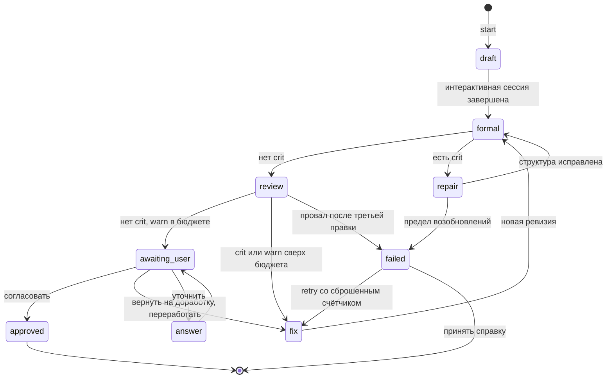
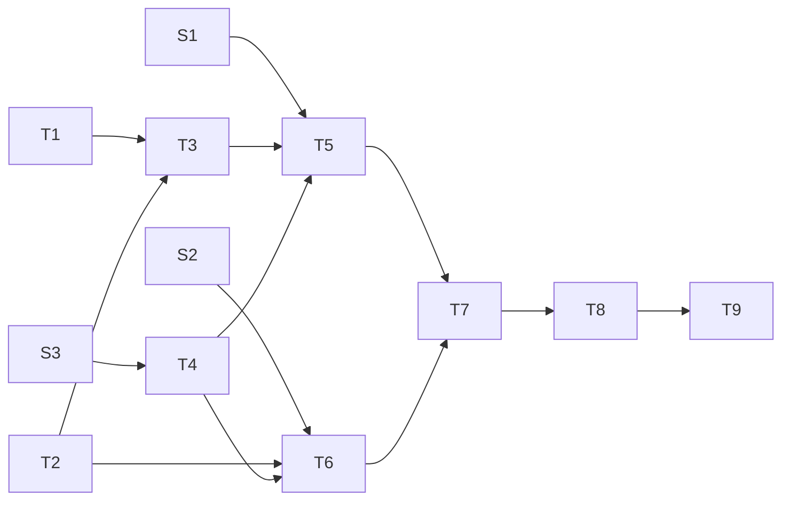

# План построения harness-планера `plan/iter`

Дата: 2026-10-06, сверено с репозиторием 2026-10-14.

Статус на 2026-10-14: S1–S3 закрыты, T1–T8 реализованы в
`@shahimat/harness` (`src/plan`, `src/fsm`, `src/handlers`, `src/runner`,
`src/store`, определение — `harnesses/plan/iter/`). Открыт T9 — сквозной
прогон на реальной задаче: нужен человек в терминале. Ответы spike и
отклонения от плана — в разделе «Итоги spike и отклонения».

Добавляем в `@shahimat/harness` категорию `plan`, которая ведёт планирование задачи как конечный автомат поверх Claude Code. Построение идёт тем же способом, каким harness будет планировать: три spike снимают неизвестные, девять задач доведены до DoD, остальное вынесено за горизонт. Пункты ниже оформлены в формате будущего плана.

## Схема процесса

Один прогон `plan/iter`. Переходами управляет скрипт, модель работает только внутри состояний.



| Состояние | Кто работает | Вход | Выход |
| --- | --- | --- | --- |
| `draft` | Планер, интерактивный `claude` в каталоге проекта | Название, запрос, правила и документация проекта | `plan.md`, `context.md` |
| `formal` (1a) | Скрипт, без LLM | `plan.md` | Перепроверка структуры; в норме проходит всегда |
| `repair` | Планер, та же сессия через `--resume` | Нарушения структуры | Исправленный `plan.md`; попытка не тратится |
| `review` (1b + 2) | Дешёвая модель без сети и сильная модель с сетью, headless | Только `plan.md`; стадии 2 ещё проект | Замечания JSON с ID пунктов |
| `fix` | Планер, новый headless-контекст | `plan.md`, `context.md`, замечания или пункты и комментарий пользователя | Новая ревизия `plan.md` |
| `awaiting_user` | Вы, меню в терминале | `plan.md`; HTML по команде `render` | Одно из четырёх действий |
| `answer` | Планер, headless | Вопрос, `plan.md`, `context.md` | Ответ; `plan.md` не меняется |
| `failed` | Скрипт | Замечания всех итераций | `failure-report.md` |

В состояниях `draft` и `fix` планер сам прогоняет проверку 1a, как тесты, и чинит структуру в своём контексте. Правка по вашему возврату запускает новый цикл ревью со своим счётчиком из трёх попыток.

## Принятые решения

| Тема | Решение |
| --- | --- |
| Источник истины | Один `plan.md` — результат планера. HTML для просмотра — производное, его собирает отдельная команда `render`. Графики в Mermaid. |
| Стек | Node ≥ 24, TS по правилам репозитория (`strict`, `noUncheckedIndexedAccess`, `exactOptionalPropertyTypes`). Только TS, без shell-скриптов: CI идёт на ubuntu, macos и windows. |
| Пакет и команда | Тот же `@shahimat/harness` и его `bin`. Глобальная установка — лаунчер из design v3, 7.2: в проекте с `context/harness.yml` другой версии проектные команды идут через `npx` закреплённой версии, `plan` и `session` выполняет он сам. |
| Размещение | Всё в `~/.config/harness/`; каталог переопределяется параметром, чтобы тесты не трогали домашний. В проект попадает только то, что вы выгрузили командой `clone`. |
| Оркестрация | Скрипт-FSM. Топология и параметры в YAML, формат — JSON Schema в `expectations/schemas/`, проверка `ajv`. Обработчики в TS, свои подключаются как плагины — тем же механизмом, что `defineCheck` проекта (design v3, 7.3). |
| Запуск моделей | Первичный диалог в обычном интерактивном `claude`. Ревью и правки в headless-режиме. |
| Уровни замечаний | `crit`, `warn`, `info` — как у ожиданий репозитория. Уровень задаёт критерий, а не модель. |
| Бюджет | На стадию: `crit` 0, `warn` 3; `info` не блокирует. Бюджеты стадий не суммируются. |
| Лимит попыток | Общий счётчик: 3 правки на цикл ревью. Четвёртый провал даёт справку. Провал 1a попытку не тратит. |
| Проверка 1a | Планер запускает её сам командой `check`. Stop-hook страхует. В автомате она остаётся перепроверкой. |
| Файл контекста | Читает только планер. Ревьюеры видят только план. |
| Действия пользователя | Согласовать, вернуть на доработку, переработать, уточнить. Меню в терминале. |
| Коды выхода | Общие для harness: 0 — ok, 1 — нарушения, 2 — ошибка вызова или конфигурации. |
| План в проекте | `clone md [--out <path>]` кладёт `plan.md` в проект; без `clone` проект не меняется. |
| Горизонт планирования | Задачи и spike. Дальше нерешённого spike не планируем. |
| После spike | Новая сессия, без ссылки на прежнюю. |

## Архитектура и размещение

Пакет `@shahimat/harness` делится на слои с импортом только вниз: `shared` → `lib` → `commands` → `scripts` → `harness`. Команда — атомарная операция, скрипт — последовательность команд, harness — автомат. Узел дерева CLI объявляет вид и эффект (`query` / `mutation`); модель внутри состояния получает только query и не получает skills. Категория живёт в слое `harness`: общее ядро `src/harness/core/` и скоуп `src/harness/plan-iter/`, они видны друг другу и снаружи только через свои `index.ts`.

| Модуль | Отвечает за |
| --- | --- |
| `tree.ts` (корень `src/`) | Общее дерево команд `COMMANDS` с видом и эффектом узлов; оболочка и help строятся из него |
| `harness/core/fsm` | Загрузка и проверка `harness.yaml`, исполнение переходов, возобновление |
| `harness/core/plugins` | Загрузка пользовательских действий и guards |
| `harness/core/runner` | Запуск интерактивного `claude` и headless-прогонов |
| `harness/core/store` | Сессии, артефакты, журнал |
| `harness/plan-iter` | Действия и guards `plan/iter`, операции CLI `plan` и `session`, разбор `plan.md`, формальные проверки, рендер HTML |

Сделано после плана: каталог модулей harness с общими операциями `session` и процессы агента `docs/delta` (дельта документации: `apply` → `verify` → `close`) и `source/sync` (`outdated` → `update` → `refresh`) — в состоянии агента процесс останавливается с заданием, `session resume` продолжает. За горизонтом — цикл судьи ожиданий (`expect judge` → судья → `--apply`) как процесс и вынос план-специфичных данных (`DEFAULT_MODELS`, поля плана в `SessionData`) из ядра.

```text
~/.config/harness/
  config.yaml                  # модели, бюджеты
  harnesses/plan/iter/         # ваши варианты и переопределения встроенных
    harness.yaml               # автомат: состояния, переходы, лимиты
    criteria.yaml              # единая точка ожиданий от плана
    prompts/*.md
    handlers/*                 # плагины
  sessions/<название>-<timestamp>/
    session.json               # состояние автомата, каталог проекта, счётчики
    plan.md                    # источник истины
    context.md                 # решения, отвергнутые варианты, факты, ответы на «уточнить»
    plan.html                    # производное, пишет render
    review/<n>/findings.json
    failure-report.md
    log.jsonl
```

Встроенные определения лежат в репозитории в `harness/packages/harness/harnesses/plan/iter/` и поставляются в `files` пакета. В `prompts/index.yml` они не входят: версионируются вместе с пакетом. Каталог `~/.config/harness/harnesses/` их дополняет и переопределяет.

## Контракт плана

Структура `plan.md` фиксирована, поэтому скрипт разбирает его в типизированную модель и обратно без третьего представления.

```markdown
---
harness: plan/iter
session: <название>-<timestamp>
status: draft | awaiting-user | approved
revision: 4
---
# <Название>

## Цель
## Схема            <!-- пишет скрипт из «Зависит от» -->
## Пункты

### T1. <название>
- Тип: task
- Зависит от: S1
- Мотивация: <зачем, одной-двумя фразами>
- DoD:
  - [ ] <проверяемое ожидание>

### S1. <вопрос>
- Тип: spike
- Вопрос: <что неизвестно>
- Ожидаемое решение: <какой выбор будет сделан>
- Таймбокс: <срок>

## За горизонтом    <!-- что не планируем и какой spike это разблокирует -->
## Точки улучшения  <!-- пишет скрипт: warn и info -->
```

- Префикс `T1`/`S1` служит стабильным ID. К нему привязаны замечания, граф зависимостей и проверка диффом.
- Секции «Схема» и «Точки улучшения» принадлежат скрипту. Ревью и проверка диффом их пропускают.
- Мотивация пункта остаётся в плане, потому что её читает следующий harness. Развёрнутые рассуждения уходят в `context.md`.

## Ревью

Рекомендую режим `collect`: 1a работает шлюзом, а 1b и стадия 2 запускаются вместе, и планер получает одно задание на правку.

| Стадия | Исполнитель | Что проверяет | Доступ |
| --- | --- | --- | --- |
| 1a | Скрипт | Обязательные секции и поля, существование и ацикличность зависимостей, точные дубли, поля spike | `plan.md` |
| 1b | Дешёвая модель | Ошибки в тексте, противоречия, смысловые дубли, «оправдания», «вода», перекос структуры | `plan.md` |
| 2 | Сильная модель | Достоверность утверждений о проекте и внешних фактах, достаточность DoD, планирование дальше нерешённого spike | `plan.md`, проект, сеть |

- **Почему collect.** При общем лимите в три попытки дефицитны попытки, а не токены. Последовательный режим тратит попытку на замечания 1b и лишь затем узнаёт о замечаниях стадии 2.
- **Почему 1a остаётся шлюзом.** Ревью сломанной структуры бессмысленно.
- **Почему 1a не расходует попытки.** Планер запускает ту же проверку сам командой `check` и чинит нарушения, не теряя контекста. Stop-hook страхует: он блокирует завершение хода, если `plan.md` изменён и не проходит проверку (способ доставки hook уточняет S1).
- **Что значит провал 1a в автомате.** Сессию оборвали или сломан механизм. Автомат возобновляет ту же сессию планера через `--resume`, счётчик попыток не меняется.
- **Предел.** `formal.max_blocks` в `harness.yaml` ограничивает число блокировок hook подряд и число возобновлений; по умолчанию 3 (предложение). После предела автомат уходит в `failed` со справкой.
- **Вердикт считает скрипт.** Любой `crit` останавливает движение. `warn` останавливает, когда в одной стадии их больше бюджета (3). `info` не останавливает никогда. Ответ модели вне JSON-схемы отклоняется.
- **Переключатель.** `review.mode: collect | sequential` в `harness.yaml`. Режим `sequential` дешевле на планах, которые часто падают на 1b.
- **Критерии.** Каждая запись в `criteria.yaml` содержит ID, стадию, уровень и формулировку; формат — `expectations/schemas/plan-criteria.schema.json`. Это единственное место, где вы описываете ожидания от плана. Устройство то же, что у ожиданий репозитория: уровни, бюджет, механическая проверка до смысловой.
- **Справка о провале.** Таблица «критерий × итерация». Критерий, упавший во всех итерациях, помечается как кандидат на переформулировку.

## CLI

Каждая команда работает и внутри оболочки, и одной строкой из шелла: `harness plan iter start`. Проектные команды (`check`, `changelog lint`, `expect …` и др.) остаются на верхнем уровне.

```text
/harness                      list · help · <категория> · session
/harness/plan                 list · help · <harness> · ..
/harness/plan/iter            start · validate · graph · help · ..
/harness/session              list · help · <сессия> · ..
/harness/session/<сессия>     status · resume · retry · check · render · read · clone * | md · help · ..
```

- `start` спрашивает название плана и запрос, создаёт сессию `<название>-<timestamp>` и запоминает каталог проекта.
- `check` прогоняет проверку 1a и печатает нарушения; код 1 при `crit`. Её вызывают планер, Stop-hook и вы.
- `render [--out <file>]` собирает HTML из `plan.md`: по умолчанию `plan.html` в каталоге сессии.
- `read` собирает HTML, если он устарел, и открывает его в браузере.
- `clone *` копирует в текущий каталог все экспортируемые артефакты сессии, `clone md` только Markdown. `--out <path>` задаёт место в проекте.
- `validate` проверяет `harness.yaml`, `graph` печатает Mermaid самого автомата.
- Дерево команд описано декларативно (`src/tree.ts`, общее с проектными командами), `help` и `list` строятся из него.

## Механики Claude Code

Сверено с документацией 2026-10-06. Ссылки в разделе «Источники».

| Факт | Как используем |
| --- | --- |
| `claude "запрос"` открывает интерактивную сессию с начальным промптом. `--append-system-prompt-file` работает в интерактивном режиме. | Роль планера и контракт плана |
| `--add-dir` даёт доступ к каталогу вне проекта, не подхватывая оттуда конфигурацию. | План и контекст пишутся в каталог сессии |
| `--settings <файл или JSON>` действует одну сессию, стоит выше user, project и local и ничего не пишет на диск. | Разрешения прогона без записи в проект |
| `--session-id <uuid>`, `--name`, `--resume`. | Связь сессии harness с транскриптом |
| Stop-hook блокирует остановку: код выхода 2 или `decision: "block"` с `reason`. SessionEnd блокировать не может. | Самопроверка 1a внутри хода планера |
| `claude -p --output-format json --json-schema` кладёт результат в `structured_output`. Код выхода 0 при успехе. `--max-turns` ограничивает ходы. | Замечания ревьюера как типизированный JSON |
| Agent SDK: пакет `@anthropic-ai/claude-agent-sdk`, `query()`, `outputFormat: {type: "json_schema"}`. Схема в draft-07: берём JSON Schema из `expectations/schemas/`. | Альтернатива подпроцессу `claude -p` |
| Алиасы моделей: `haiku`, `sonnet`, `opus`, `fable`, `best`. | Дешёвая модель для 1b, сильная для планера и стадии 2 |
| WebSearch и WebFetch требуют разрешения. `--allowedTools` разрешает, `--disallowedTools` убирает инструмент. | Сеть только у стадии 2 |
| `-p` без `--bare` исполняет hooks проекта и подключает его `.mcp.json` без диалога доверия. | Риск для headless-стадий, см. S2 |
| `--bare` пропускает hooks, `CLAUDE.md` и логин подписки, требует API-ключ. Документация обещает сделать его поведением `-p` по умолчанию. | Флаги задаём явно, на умолчания не полагаемся |
| Подписка из `/login` стоит последней в порядке выбора учётных данных. `ANTHROPIC_API_KEY` в окружении перебивает её в `-p`. `claude setup-token` выдаёт токен подписки для скриптов. | Авторизация headless-стадий, см. S2 |

Документация не даёт ответа на два вопроса, оба уходят в S1:

- Исполняются ли hooks, переданные через `--settings`. Страница настроек говорит, что флаг задаёт любой ключ пользовательского файла, но таблица мест объявления hooks его не называет. Запасной путь: `--plugin-dir` с `hooks/hooks.json`.
- Как отключить hooks проекта, сохранив чтение его `CLAUDE.md`. `disableAllHooks` отключает и наш hook, а исключение источника `project` убирает вместе с hooks и инструкции проекта.

## Этапы построения

S1–S3 и T1–T2 не зависят друг от друга и стартуют сразу. Самая длинная цепочка зависимостей: T2 → T3 → T5 → T7 → T8 → T9.



### S1. Интерактивная сессия под управлением обёртки

- Тип: spike
- Вопрос: можно ли запустить `claude` из скрипта с ролью планера, доступом к каталогу сессии и собственным Stop-hook, ничего не записав в проект и не исполнив hooks проекта?
- Ожидаемое решение: набор флагов запуска; способ доставки hook (`--settings` или `--plugin-dir`); поведение по отношению к hooks проекта.
- Таймбокс: полдня (предложение)

### S2. Headless-прогон и авторизация

- Тип: spike
- Вопрос: что надёжнее для ревью и правок, Agent SDK или подпроцесс `claude -p`? Стабильно ли дешёвая модель возвращает JSON по схеме? Под какими учётными данными идут прогоны?
- Ожидаемое решение: транспорт headless-стадий; способ авторизации; полный список явных флагов.
- Таймбокс: полдня (предложение)

### S3. Обратимость разбора Markdown

- Тип: spike
- Вопрос: даёт ли цикл «разбор → модель → запись» побайтно тот же файл, и можно ли по диффу моделей доказать, что изменены только выбранные пункты?
- Ожидаемое решение: библиотека разбора (кандидат: remark); гранулярность диффа; правила оформления, которые планер обязан соблюдать.
- Таймбокс: полдня (предложение)

### T1. Каркас пакета и оболочка CLI

- Тип: task
- Зависит от: —
- Мотивация: единая точка входа для всех будущих категорий harness.
- DoD:
  - [ ] `npm i -g` даёт команду `harness`
  - [ ] Работают неймспейсы из раздела «CLI», переход `..`, `list` и `help` на каждом уровне
  - [ ] Любая команда выполняется одной строкой из шелла
  - [ ] `help` и `list` строятся из декларативного дерева команд
  - [ ] Компиляция по правилам репозитория без ошибок; разбор команд покрыт тестами

### T2. Ядро FSM и декларация в YAML

- Тип: task
- Зависит от: —
- Мотивация: разные реализации harness должны отличаться файлом, а не кодом.
- DoD:
  - [ ] JSON Schema `harness.yaml` лежит в `expectations/schemas/`, ею же проверяют конфиг рантайм (`ajv`) и редактор
  - [ ] Статическая проверка графа: все состояния достижимы, нет тупиков, у каждого цикла есть лимит
  - [ ] Guards и действия вызываются по имени из реестра; YAML не содержит выражений
  - [ ] Обработчики из `handlers/` загружаются динамическим `import()`; загрузка `.ts` без сборки проверена, иначе принят формат `.js`
  - [ ] Прерванный прогон продолжается с сохранённого состояния
  - [ ] `validate` сообщает ошибку с путём до поля; `graph` печатает Mermaid автомата

### T3. Сессии и хранилище

- Тип: task
- Зависит от: T1, T2
- Мотивация: план живёт в user scope, а проект остаётся чистым.
- DoD:
  - [ ] `start` создаёт каталог сессии и запоминает каталог проекта
  - [ ] `session list` показывает сессии с состоянием автомата
  - [ ] `clone *` и `clone md` копируют артефакты в текущий каталог или в `--out`
  - [ ] Без `clone` в проекте не появляется ни одного файла
  - [ ] Каждый переход автомата записан в `log.jsonl`

### T4. Контракт плана: разбор, проверки, представление

- Тип: task
- Зависит от: S3
- Мотивация: формальная проверка и HTML должны получаться из одного файла без участия модели.
- DoD:
  - [ ] `plan.md` разбирается в типизированную модель и записывается обратно без изменений
  - [ ] Проверки 1a из раздела «Ревью» реализованы и покрыты тестами на заведомо сломанных планах
  - [ ] `check` печатает нарушения с ID пункта и возвращает 1 при `crit`
  - [ ] Блок «Схема» генерируется из зависимостей пунктов
  - [ ] Секция «Точки улучшения» генерируется из замечаний
  - [ ] `render` пишет самодостаточный HTML с отрисованным Mermaid
  - [ ] `read` пересобирает устаревший HTML и открывает его в браузере

### T5. Стадия планирования

- Тип: task
- Зависит от: S1, T2, T3, T4
- Мотивация: первичный диалог остаётся в привычном интерфейсе, а его результат гарантированно пригоден для ревью.
- DoD:
  - [ ] `start` открывает интерактивный `claude` в каталоге проекта с ролью планера и вашим запросом
  - [ ] По завершении в каталоге сессии лежат `plan.md` и `context.md`
  - [ ] Промпт планера требует запускать `check` перед сдачей плана и чинить нарушения
  - [ ] Stop-hook блокирует завершение хода, если `plan.md` изменён и не проходит `check`
  - [ ] Stop-hook молчит, пока `plan.md` не существует или не менялся с прошлой проверки
  - [ ] После `formal.max_blocks` блокировок подряд hook отпускает планера, автомат переходит в `failed`
  - [ ] Провал 1a в автомате возобновляет ту же сессию через `--resume`
  - [ ] Промпт планера задаёт горизонт: задачи и spike, ничего дальше нерешённого spike
  - [ ] После сессии `git status` проекта не показывает изменений

### T6. Ревью

- Тип: task
- Зависит от: S2, T2, T4
- Мотивация: ожидания от плана настраиваются в одном файле и проверяются без влияния контекста планера.
- DoD:
  - [ ] `criteria.yaml` задаёт для критерия ID, стадию, уровень и формулировку
  - [ ] 1b идёт на дешёвой модели без сети, стадия 2 на сильной с сетью
  - [ ] Ревьюеры не получают `context.md`
  - [ ] Замечание соответствует схеме: критерий, ID пункта, описание
  - [ ] Вердикт вычисляет скрипт по правилам раздела «Ревью»
  - [ ] Работают оба режима, `collect` и `sequential`
  - [ ] `warn` и `info` попадают в «Точки улучшения»

### T7. Цикл правки и справка о провале

- Тип: task
- Зависит от: T5, T6
- Мотивация: неудачный прогон должен объяснять, что чинить в самом механизме.
- DoD:
  - [ ] Правка идёт в новом контексте со входом: `plan.md`, `context.md`, замечания
  - [ ] Планер-исправитель прогоняет `check` до завершения; на ревью приходит структурно валидный план
  - [ ] Провал 1a после правки возобновляет сессию исправителя и не уменьшает счётчик попыток
  - [ ] После третьей неудачной правки автомат переходит в `failed`
  - [ ] `failure-report.md` содержит таблицу «критерий × итерация» и отмечает повторяющиеся критерии
  - [ ] `retry` обнуляет счётчик и запускает цикл заново

### T8. Действия пользователя

- Тип: task
- Зависит от: T7
- Мотивация: решение по плану принимается в терминале за один проход.
- DoD:
  - [ ] Меню предлагает: согласовать всё, вернуть всё с комментарием, пройти по пунктам, переработать, уточнить
  - [ ] При проходе по пунктам нормальные пропускаются одним нажатием, отмеченные получают необязательный комментарий
  - [ ] «Переработать» не принимается без комментария
  - [ ] После «вернуть на доработку» дифф подтверждает, что изменены только отмеченные пункты и зависящие от них; иначе ревизия отклоняется
  - [ ] После «уточнить» `plan.md` побайтно прежний, ответ дописан в `context.md`
  - [ ] Любая правка проходит полный цикл ревью
  - [ ] «Согласовать» ставит `status: approved`, дальнейшие правки плана запрещены

### T9. Сквозной прогон на реальном проекте

- Тип: task
- Зависит от: T8
- Мотивация: критерии и промпты калибруются только на настоящей задаче.
- DoD:
  - [ ] Одна реальная задача проведена от `start` до `approved`
  - [ ] Переход в `failed` и справка проверены на искусственно завышенных критериях
  - [ ] `criteria.yaml` и промпты исправлены по итогам прогона

## Итоги spike и отклонения

Проверено на `claude` 2.1.296 2026-10-14.

- **S1.** Все прогоны идут с `--setting-sources ""`: settings, hooks и
  `CLAUDE.md` пользователя и проекта не загружаются, а Stop-hook из
  `--settings` исполняется. `--safe-mode` не подходит: он отключает и
  hook из `--settings`, и `--plugin-dir`. Правила проекта планер читает
  как файлы — так велит его промпт. Что hooks проекта при этих флагах не
  исполняются, напрямую не проверено (hook `settings_guard` не дал
  записать тестовый `.claude/settings.json`); вывод — по семантике
  `--setting-sources`.
- **S2.** Транспорт — подпроцесс `claude -p --output-format json
  --json-schema`, Agent SDK не нужен. `haiku` стабильно отвечает по
  схеме с `enum` критериев и `pattern` ID пункта. Вход — подписка из
  `/login`: `--setting-sources ""` её не отключает, API-ключ не нужен.
  Без `--setting-sources ""` в прогон попадает глобальный `CLAUDE.md`
  пользователя, и ревьюер придумывает свои критерии.
- **S3.** Remark не нужен: план режется построчно на сырые блоки
  (frontmatter, разделы, пункты), запись обратно — их конкатенация,
  побайтно тот же файл (в том числе CRLF). Дифф — по сырому тексту
  пунктов с ID; разделы скрипта и frontmatter в дифф не входят.
- **Лимиты.** `formal.max_blocks` из плана — `limits.formal` в
  `harness.yaml`, рядом с `limits.fix`: переход со `count` берётся, пока
  счётчик меньше лимита, `reset` обнуляет. Цикл без лимита допустим
  только через состояние с `actor: user`.
- **Провал.** Из `failed` один выход — `retry`; «принять справку» —
  оставить сессию в `failed`, отдельной команды нет.
- **HTML.** Схема зависимостей рисуется своим SVG, без Mermaid-скрипта:
  так файл самодостаточен и не ходит в сеть.
- **`clone *`.** В шелле звёздочку нужно экранировать:
  `harness session <сессия> clone '*'`.
- **Лаунчер** из design v3, 7.2 (проектные команды через `npx`
  закреплённой версии), не сделан: в DoD пунктов его нет.

## За горизонтом

- **Следующий harness (исполнение плана).** Контракт передачи зависит от формата пунктов, который закрепит T9.
- **Другие категории, например `pr-review`.** Нужен работающий `plan/iter` как образец декларации.
- **Удешевление стадии 2: проверка только изменённых пунктов.** Требует данных о стоимости из T9 и диффа из S3.
- **Публикация пакета за пределы личного использования.** Упирается в способ авторизации из S2.
- **Автодополнение команд в zsh.** Строится из дерева команд T1, на процесс не влияет.
- **docs-keeper как процесс harness.** Сейчас дельту документации ведёт субагент docs-keeper. Когда S2 даст транспорт headless-прогонов, его можно перенести в процесс harness (например, `harness docs apply`): независимый контекст, который чистится после прогона.
- **Живое обновление HTML.** Локальный сервер с перезагрузкой страницы; пока хватает `render` и `read`.

## Открытые вопросы

Вопросы 3, 4 и 6 закрыты реализацией: режим `collect`, hooks проекта не
исполняются (S1), модели `haiku` для 1b и `opus` для планера и стадии 2
— в `harness.yaml`. Вопрос 1 для личного использования закрыт S2.

1. **Авторизация headless-стадий: подписка или API-ключ?** На вашей машине `claude -p` работает под логином подписки. Документация Agent SDK не разрешает сторонним разработчикам предлагать вход через claude.ai в своих продуктах. Для личного инструмента это не препятствие; при публичной публикации пакета рассчитывайте на API-ключ. Это не юридическая консультация.
2. **Реестр npm: публичный или приватный?** От ответа зависит предыдущий пункт.
3. **Режим ревью по умолчанию.** Рекомендация: `collect`.
4. **Hooks проекта во время планирования.** Игнорировать ради чистоты прогона или исполнять, как в обычной сессии? S1 покажет, возможно ли первое.
5. **Таймбокс spike.** Полдня на каждый указаны как предложение.
6. **Модели по умолчанию.** Предлагаю `haiku` для 1b и `opus` для планера и стадии 2.

## Встраивание в репозиторий

- Версия: планер идёт в текущую неопубликованную версию `@shahimat/harness` (правило — `CLAUDE.md`, «Публичные npm-пакеты»).
- Ожидания: принятые решения плана — раздел `[harness] plan_iter` в `expectations/harness-plan-iter.expect.ts`. DoD пунктов остаётся здесь.
- Общие для всего harness решения (дерево команд, путь до поля в ошибке конфига, односторонние слои, проверки не пишут в проект, правила работы с моделями, плагины из конфига) — общие разделы того же файла.
- Контракт v3: в проект ничего не ставится; в skill `harness` — строка про `harness plan iter start` для больших задач.

## Источники

- [CLI reference](https://code.claude.com/docs/en/cli-reference)
- [Hooks reference](https://code.claude.com/docs/en/hooks)
- [Settings files and precedence](https://code.claude.com/docs/en/settings)
- [Configure permissions](https://code.claude.com/docs/en/permissions)
- [Run Claude Code programmatically](https://code.claude.com/docs/en/headless)
- [Authentication](https://code.claude.com/docs/en/authentication)
- [Model configuration](https://code.claude.com/docs/en/model-config)
- [Agent SDK overview](https://code.claude.com/docs/en/agent-sdk/overview)
- [Agent SDK reference, TypeScript](https://code.claude.com/docs/en/agent-sdk/typescript)
- [Structured outputs](https://code.claude.com/docs/en/agent-sdk/structured-outputs)
