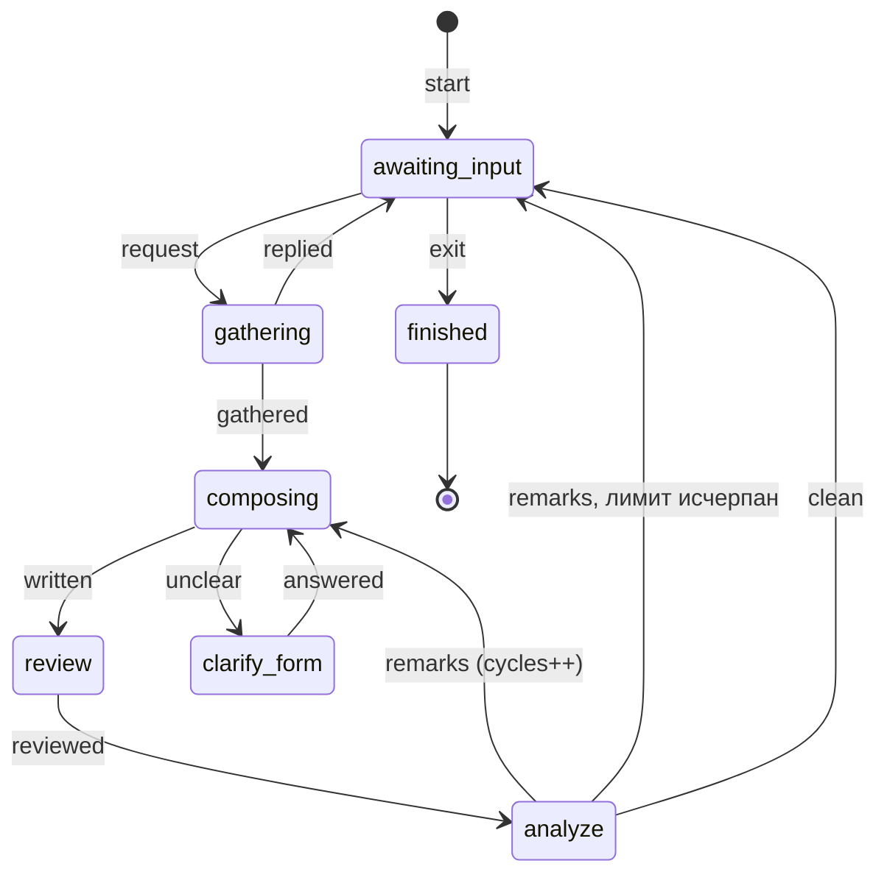

# Harness-планер `plan-review`

Статус: заморожен (2026-10-28). Работает как есть и не развивается:
такие harness ставятся по ходу дела, а не в контракт v3. Роли и
протокол (`design/roles.md`) его пока не касаются — при разморозке
планер и судья переходят на роли.

Дата: 2026-10-21. Вторая схема: результат планера — файл ожиданий.

Источник истины — блок `fsm` и ожидания в
`expectations/harness-plan-review.expect.ts`; `harness.yaml` с ним
совпадает (проверка `Graph.sameAs`). Этот документ объясняет решения и
их причины; правила, которые проверяются, живут в ожиданиях.

## Назначение

Интерактивный планер: из запроса пользователя строит ожидания в файле
`*.expect.ts` и проверяет их ревью судьёй. Мотивация — предсказуемость:
план — это ожидания, которые потом проверяются той же машиной, что и
реализация.

```text
ai plan-review start <file> [--request <запрос>]
```

Существующий файл — план изменения его состояния; нового нет —
создаётся каркас с `plan({ name })`. Смотреть план —
`ai expect serve <file>`.

## Автомат



| Состояние | Кто работает | Что происходит |
| --- | --- | --- |
| `awaiting_input` | пользователь | Планер ждёт запроса; файл ожиданий не меняется |
| `gathering` | планер | Сбор контекста, большие обзоры — субагентами (`Agent`); ход без записи файла возвращает в `awaiting_input` |
| `composing` | планер | Запись ожиданий только из блоков механизма; без проверки — заглушка |
| `clarify_form` | пользователь | Выбор блока, которым строить ожидания (`AskUserQuestion`) |
| `review` | судья | `expect judge` по файлу плана; итог — по бюджету файла |
| `analyze` | код и планер | Код сравнивает находки с бюджетом, планер разбирает и поясняет |
| `finished` | — | Сессия завершена |

Лимиты в `harness.yaml`: `cycles` — циклы `composing → review →
analyze` без чистого ревью (3), `build` — блокировки конца хода, пока
файл не собирается (3). Счётчик `cycles` обнуляется новым запросом.

## Принятые решения

| Тема | Решение |
| --- | --- |
| Результат | Файл ожиданий `<file>` в проекте. `plan.md`, критерии плана и HTML-рендер плана первой схемы удалены. |
| Кто переключает | Автомат. Планер — часть автомата и состояния не меняет: события выводит команда `hook` из действий планера, которые видны через hooks его сессии. |
| Выход | Слово «выход» от пользователя в `awaiting_input`, или флаг `[plan-review: exit]` последней строкой ответа планера. Флаг автомат читает на `Stop` после стадии и выходит только при чистом ревью; иначе выход отложен. После выхода harness сам закрывает сессию планера: `/exit` недоступен (слэш-команды отключены). |
| Пауза | Ctrl+C или Ctrl+D в любом состоянии: автомат остаётся на месте, файл — в последнем записанном виде, `open <id>` продолжает ту же сессию через `--resume`. Ctrl+C не выход: по нему не отличить «закончил» от «закрыл окно». |
| Страница плана | Сессия планера поднимает `expect serve <file>` на свободном порту и открывает её в браузере; сервер гаснет с сессией. Адрес — в промпте планера и в ответе чистого ревью. |
| Без терминала | `start` и `open` встают на паузу с подсказкой `open`; интерактивный планер запускается только в терминале. |
| Ревью | Судья — headless без сети и без записи (`Read`, `Glob`, `Grep`), ответ по `--json-schema`; harness сам пишет ответ, применяет вердикты и считает итог по бюджету файла. Правка файла судьёй откатывается. |
| Сборка перед ревью | Сбор ожиданий vitest и `tsc` ближайшего `tsconfig.json`. Не собирается — `Stop` возвращает планеру ошибки, не больше `limits.build` раз подряд. |
| Права планера | Чтение проекта, запись только файла ожиданий (`Edit`/`Write` по пути и hook `PreToolUse`), Bash — только `expect report` своего файла (hook `PreToolUse` на Bash: режим auto его не обходит), субагенты, `AskUserQuestion`. Справочник блоков с примером — в промпте: исходники harness планеру не нужны. |
| Модели | `models.planner` и `models.judge` в `harness.yaml`, по умолчанию `opus`. |
| Размещение | Сессии — `~/.config/harness/sessions/<sha256>/` (`--home`, `HARNESS_HOME`); в проект пишутся только файл ожиданий, кэш вердиктов и задания судьи (`.judge/`) рядом с ним. |

## Hooks сессии планера

Команда `ai plan-review hook <id> <hook>` читает JSON hook со stdin
и решает по состоянию автомата.

| Hook Claude Code | `<hook>` | Событие |
| --- | --- | --- |
| `UserPromptSubmit` | `prompt` | `awaiting_input`: «выход» — `exit`, иначе `request` |
| `PreToolUse` Edit/Write | `edit` | `gathering` — `gathered`; другой файл или правка вне `gathering`/`composing` — блок |
| `PreToolUse` Bash | `bash` | Только `expect report` своего файла, остальное — блок |
| `PreToolUse` AskUserQuestion | `ask` | `composing` — `unclear` |
| `PostToolUse` AskUserQuestion | `answer` | `clarify_form` — `answered`; ответ доходит до планера дословно |
| `Stop` | `stop` | `gathering` — `replied`; `composing`: сборка → `written` → ревью → разбор; флаг выхода после стадии: в `awaiting_input` — `exit`, если последнее ревью чистое |
| `SessionEnd` | `end` | Событий нет: пауза, запись в журнал сессии |

Ответ hook планеру: на `Stop` — JSON `{"decision": "block", "reason"}`
с кодом 0 (замечания ревью, ошибки сборки, «выход отложен»), на
остальных — код 2 и текст в stderr. После `finished` сообщения и правки
блокируются с подсказкой закрыть сессию.

## Размещение

```text
packages/harness/src/harnesses/plan-review/
  harness.yaml        # автомат, лимиты, модели
  prompts/planner.md  # роль планера, якорь @planner-role
  prompts/judge.md    # роль судьи
  actions.ts          # действия состояний, hooks в --settings, права планера
  hook.ts             # hook → событие, Stop: сборка, ревью, флаг выхода
  page.ts             # страница плана: expect serve на время сессии планера
  review.ts           # судья поверх expect judge, сводка по бюджету
  cli.ts, load.ts

~/.config/harness/sessions/<sha256>/
  session.json        # состояние автомата, файл плана, сессия планера
  plan-review.json    # номер ревью, хеш проверенного файла, блокировки сборки, адрес страницы
  review/<n>.json     # итог ревью: счётчики, провалы, замечания
  log.jsonl           # переходы, паузы, ревью
```

Ядро `harnesses/core` не знает plan-review: поля и файлы сессии
plan-review — в его каталоге.

## Проверенные факты Claude Code

Проверено на `claude` 2.1.296 (spike первой схемы, 2026-10-14):

- С `--setting-sources ""` settings, hooks и `CLAUDE.md` пользователя и
  проекта не загружаются, а hook из `--settings` исполняется. Правила
  проекта планер читает как файлы.
- Headless — подпроцесс `claude -p --output-format json --json-schema`;
  вход — подписка из `/login`, API-ключ не нужен.

Проверено пробными сессиями 2026-10-21: начальный промпт из `--request`
вызывает hook `UserPromptSubmit`; закрытие сессии даёт `SessionEnd` с
`reason: prompt_input_exit`; в режиме auto Bash планера проходит мимо списка
разрешений — отсюда hook на Bash; ответ `Stop` Claude Code подписывает
«Stop hook error» и при JSON `decision: block`. Просьба выйти без правки
файла застревала в `gathering` — отсюда переход `replied`.

Проверено пробой 2026-10-22: сквозной прогон `ai plan-review start`
в терминале — запрос, вопросы, запись, ревью, страница, `replied`;
`last_assistant_message` в JSON hook `Stop` несёт флаг выхода, автомат
уходит в `finished`. `--disable-slash-commands` отключает и встроенные
команды: `/exit` — «Unknown command», поэтому после выхода сессию
планера закрывает harness.

По документации (https://code.claude.com/docs/en/hooks), вживую не
проверено:

- Жёлтые предупреждения о разрешениях при интерактивном запуске
  планера: в `-p` с теми же флагами их нет, текст не снят.
- `SessionEnd` по умолчанию даёт hook 1,5 с — у нас явный `timeout`.

## Открытые вопросы

1. **Закрытие сессии планера по SIGTERM** вживую не проверено:
   восстанавливает ли Claude Code терминал и пишет ли `SessionEnd`.
2. **Ожидание «после 3 циклов…»** записывает число жёстко; при другом
   `limits.cycles` разойдётся с реализацией.

## За горизонтом

- **Режимы human и agent, веб-интерфейс сессии** (хендофф
  `~/ai-gen/harness-plan-review.md`, §3): вопросы и решения через
  страницу, ответы другим harness.
- **Skill-вход на каждый harness** (`/plan-review start …`).
- **Исполнение плана** — следующий harness по шагам из файла ожиданий.
- **Бюджет контекста планера** при длинных сессиях.

## История

Первая схема (2026-10-06 — 2026-10-16): результат — `plan.md` с
пунктами T/S и DoD, проверка структуры 1a, ревью дешёвой моделью без
сети (1b) и сильной с сетью (2), правки headless, меню решения в
терминале, `render`/`read`/`clone`. Заменена, потому что план в форме
ожиданий проверяется той же машиной, что и реализация, а живой диалог
идёт в одной интерактивной сессии планера.
