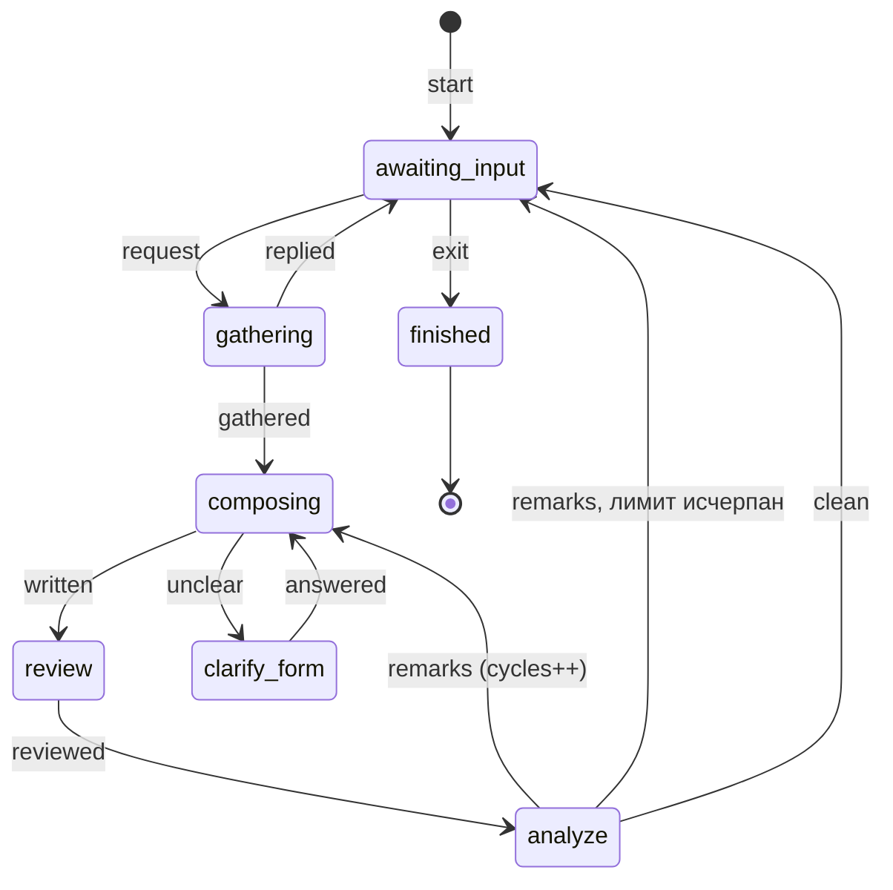

# Harness-планер `plan-review`

Статус: заморожен (2026-10-28). Работает как есть и не развивается:
такие harness ставятся по ходу дела, а не в контракт v3. Роли и
протокол (`design/roles.md`) его пока не касаются — при разморозке
планер и судья переходят на роли.

Дата: 2026-10-21. Вторая схема: результат планера — файл ожиданий.

Источник истины — блок `fsm` и ожидания в
`expectations/harness-plan-review.expect.ts`; `harness.yaml` с ним
совпадает (проверка `Graph.sameAs`). Этот документ объясняет решения и
их причины; правила, которые проверяются, живут в ожиданиях.

## Назначение

Интерактивный планер: из запроса пользователя строит ожидания в файле
`*.expect.ts` и проверяет их ревью судьёй. Мотивация — предсказуемость:
план — это ожидания, которые потом проверяются той же машиной, что и
реализация.

```text
ai plan-review start <file> [--request <запрос>]
```

Существующий файл — план изменения его состояния; нового нет —
создаётся каркас с `plan({ name })`. Смотреть план —
`ai expect serve <file>`.

## Автомат



| Состояние | Кто работает | Что происходит |
| --- | --- | --- |
| `awaiting_input` | пользователь | Планер ждёт запроса; файл ожиданий не меняется |
| `gathering` | планер | Сбор контекста, большие обзоры — субагентами (`Agent`); ход без записи файла возвращает в `awaiting_input` |
| `composing` | планер | Запись ожиданий только из блоков механизма; без проверки — заглушка |
| `clarify_form` | пользователь | Выбор блока, которым строить ожидания (флаг `[plan-review: ask]` в ответе планера) |
| `review` | судья | `expect judge` по файлу плана; итог — по бюджету файла |
| `analyze` | код и планер | Код сравнивает находки с бюджетом, планер разбирает и поясняет |
| `finished` | — | Сеанс завершён |

Лимиты в `harness.yaml`: `cycles` — циклы `composing → review →
analyze` без чистого ревью (3), `build` — блокировки конца хода, пока
файл не собирается (3). Счётчик `cycles` обнуляется новым запросом.

## Принятые решения

| Тема | Решение |
| --- | --- |
| Результат | Файл ожиданий `<file>` в проекте. `plan.md`, критерии плана и HTML-рендер плана первой схемы удалены. |
| Кто переключает | Автомат. Планер — часть автомата и состояния не меняет: события выводит команда `hook` из действий планера и событий моста его сеанса. |
| Выход | Слово «выход» от пользователя в `awaiting_input`, или флаг `[plan-review: exit]` последней строкой ответа планера. Флаг автомат читает на `stop` после стадии и выходит только при чистом ревью; иначе выход отложен. После выхода harness сам завершает сеанс планера. |
| Пауза | Ctrl+C или закрытый ввод в любом состоянии: автомат остаётся на месте, файл — в последнем записанном виде, `open <id>` продолжает тот же сеанс. Ctrl+C не выход: по нему не отличить «закончил» от «закрыл окно». |
| Страница плана | Сеанс планера поднимает `expect serve <file>` на свободном порту и открывает её в браузере; сервер гаснет с сеансом. Адрес — в промпте планера и в ответе чистого ревью. |
| Без терминала | `start` и `open` встают на паузу с подсказкой `open`; сеанс планера ведётся только в терминале. |
| Ревью | Судья — headless-прогон без сети и без записи (`Read`, `Glob`, `Grep`), ответ — единственный JSON по схеме в задании; harness сам пишет ответ, применяет вердикты и считает итог по бюджету файла. Правка файла судьёй откатывается. |
| Сборка перед ревью | Сбор ожиданий vitest и `tsc` ближайшего `tsconfig.json`. Не собирается — `stop` возвращает планеру ошибки, не больше `limits.build` раз подряд. |
| Права планера | Чтение проекта, запись только файла ожиданий (`permission.hook` плагина: правка другого файла — deny), Bash — только `expect report` своего файла (тот же hook: режим auto его не обходит), субагенты; вопрос пользователю — флаг `[plan-review: ask]` в ответе планера. Справочник блоков с примером — в промпте: исходники harness планеру не нужны. |
| Модели | `models.planner` и `models.judge` в `harness.yaml`, по умолчанию `zai-coding-plan/glm-5.3-flash#max`. |
| Размещение | Сессии — `~/.config/harness/sessions/<sha256>/` (`--home`, `HARNESS_HOME`); в проект пишутся только файл ожиданий, кэш вердиктов, задания судьи (`.judge/`) и мост (`.opencode/artifacts/plan-review/`) рядом с планом. |

## События сеанса планера

Мост планера. Перед сеансом harness пишет в проект
`.opencode/artifacts/plan-review/bridge.json`: `events` — журнал
`planner-events.jsonl` сессии, `plan` — файл ожиданий, `report` —
команда `ai expect report <file> --root <проект>`. Плагин
`@shahimat/oc3` в сеансе планера читает мост и дополняет журнал:
промпт пользователя (`kind: prompt`), правка файла ожиданий
(`kind: edit`), вызов Bash (`kind: bash`); правка другого файла и чужой
Bash — deny от `permission.hook`. Агент планера — `.opencode/agents/planner.md`
из адаптера (`ai adapters sync`); каждая стадия — отдельный
`opencode run --format json --auto --agent planner --model <модель>`
(`--session` — та же сессия, `-f` — вложения из текста), системный
промпт — из шаблона `prompts/planner.md`. После стадии harness
дочитывает новые строки журнала и скармливает их автомату.

Команда `ai plan-review hook <id> <hook>` принимает то же событие
JSON'ом со stdin и решает по состоянию автомата.

| Источник | `<hook>` | Событие |
| --- | --- | --- |
| ввод в терминале или `--request` (событие `prompt`) | `prompt` | `awaiting_input`: «выход» — `exit`, иначе `request` |
| правка файла ожиданий (событие `edit` из `planner-events.jsonl`) | `edit` | `gathering` — `gathered`; правка другого файла или правка вне `gathering`/`composing` — deny плагина |
| Bash в сеансе планера (событие `bash`) | `bash` | Только `expect report` своего файла, остальное — deny плагина |
| флаг `[plan-review: ask]` в ответе планера | `ask` | `composing` — `unclear` |
| ответ пользователя в терминале | `answer` | `clarify_form` — `answered`; ответ уходит планеру заданием следующей стадии |
| конец стадии планера | `stop` | `gathering` — `replied`; `composing`: сборка → `written` → ревью → разбор; флаг выхода после стадии: в `awaiting_input` — `exit`, если последнее ревью чистое |
| Ctrl+C / закрытый ввод | `end` | Событий нет: пауза, запись в журнал сессии |

Замечания ревью, ошибки сборки и «выход отложен» возвращаются планеру
заданием следующей стадии; команда `ai plan-review hook <id> stop`
печатает тот же текст JSON'ом `{"decision": "block", "reason"}` с кодом
0. После `finished` сообщения и правки блокируются с подсказкой
закрыть сеанс.

## Размещение

```text
packages/harness/src/harnesses/plan-review/
  harness.yaml        # автомат, лимиты, модели
  prompts/planner.md  # роль планера, якорь @planner-role
  prompts/judge.md    # роль судьи
  actions.ts          # действия состояний, мост (bridge.json, стадии), права планера
  hook.ts             # hook → событие, stop: сборка, ревью, флаг выхода
  page.ts             # страница плана: expect serve на время сеанса планера
  review.ts           # судья поверх expect judge, сводка по бюджету
  cli.ts, load.ts

.opencode/agents/planner.md   # агент планера (адаптер opencode)
.opencode/artifacts/plan-review/
  bridge.json         # мост: журнал событий, файл плана, команда отчёта

~/.config/harness/sessions/<sha256>/
  session.json        # состояние автомата, файл плана, сессия планера
  planner-events.jsonl  # журнал событий планера (пишет плагин oc3)
  plan-review.json    # номер ревью, хеш проверенного файла, блокировки сборки, адрес страницы
  review/<n>.json     # итог ревью: счётчики, провалы, замечания
  log.jsonl           # переходы, паузы, ревью
```

Ядро `harnesses/core` не знает plan-review: поля и файлы сессии
plan-review — в его каталоге.

## Мост: факты из кода

Механика моста (пакеты `harness` и `oc3`, без отдельных проверок
вживую):

- Изоляция стадии — конфиг из `OPENCODE_CONFIG_CONTENT` с единственной
  инструкцией (системный промпт планера из шаблона): настройки, skills
  и правила пользователя и проекта в стадию не попадают; правила
  проекта планер читает как файлы.
- Сессия планера одна на сеанс: первая стадия создаёт id, дальше —
  `opencode run --session`; вложения из текста (`@файл`) уходят
  флагами `-f`.
- События журнала: `prompt` (промпт пользователя), `edit` (правка файла
  ожиданий, путь нормализован), `bash` (команда и признак `allowed`);
  плагин пишет время события. Harness дочитывает журнал с офсета —
  повторное чтение после паузы ничего не теряет.
- Права: `permission.hook('evaluate')` плагина — правка любого файла,
  кроме файла ожиданий, и любой Bash, кроме команды отчёта, — deny с
  пояснением; разрешённые правки и вызовы Bash попадают в журнал.
- Вопрос пользователю планер задаёт флагом `[plan-review: ask]` в
  тексте ответа: harness уводит автомат в `clarify_form`, ответ
  пользователя из терминала уходит планеру заданием следующей стадии.
- Судья — headless-прогон роли с `Read`, `Glob`, `Grep`; ответ —
  единственный JSON по схеме в задании через `submit_result` плагина;
  текст без вызова `submit_result` — ошибка роли.

## Открытые вопросы

1. **Закрытие сеанса планера по SIGTERM** вживую не проверено:
   дописывает ли плагин событие в журнал и восстанавливает ли
   терминал.
2. **Ожидание «после 3 циклов…»** записывает число жёстко; при другом
   `limits.cycles` разойдётся с реализацией.

## За горизонтом

- **Режимы human и agent, веб-интерфейс сессии** (хендофф
  `~/ai-gen/harness-plan-review.md`, §3): вопросы и решения через
  страницу, ответы другим harness.
- **Skill-вход на каждый harness** (`/plan-review start …`).
- **Исполнение плана** — следующий harness по шагам из файла ожиданий.
- **Бюджет контекста планера** при длинных сессиях.

## История

Первая схема (2026-10-06 — 2026-10-16): результат — `plan.md` с
пунктами T/S и DoD, проверка структуры 1a, ревью дешёвой моделью без
сети (1b) и сильной с сетью (2), правки headless, меню решения в
терминале, `render`/`read`/`clone`. Заменена, потому что план в форме
ожиданий проверяется той же машиной, что и реализация, а живой диалог
идёт в одной интерактивной сессии планера.
